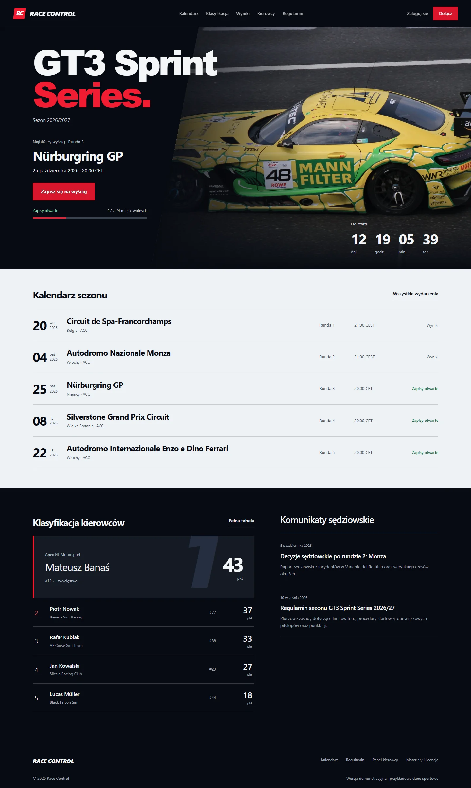
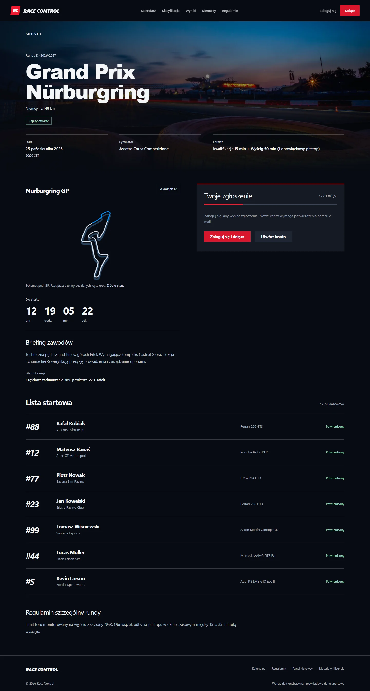

# RACE CONTROL

Publiczne demo ligi simracingowej z kontem kierowcy i panelem organizatora.

- Aplikacja: https://race-control-rho.vercel.app
- CMS: https://race-control-rho.vercel.app/admin
- Prywatne repozytorium: https://github.com/vxvxzs/race-control
- Obsługa wdrożenia, migracji, kont i kopii: [DEPLOYMENT.md](DEPLOYMENT.md).

Zrzuty przedstawiają wcześniejszą lokalną iterację tej samej aplikacji. Aktualne zrzuty publicznej produkcji znajdują się w przekazanych materiałach wdrożenia. Dane sportowe są demonstracyjne, fotografie przedstawiają rzeczywiste zawody; [źródła i licencje](ASSETS.md).

## Funkcje

Rejestracja i jednorazowa weryfikacja e-mail, sesje i profil kierowcy, zgłoszenia z decyzją stewarda, kontrola duplikatów i pojemności, prywatne hasło dla zaakceptowanego kierowcy, wyniki z DNF/DSQ i karami, klasyfikacja z countbackiem, historia kariery, trwałe powiadomienia i poczta Resend. CMS obsługuje te same reguły sportowe co własne API.

## Architektura produkcyjna

Next.js 15.5.27, React 19, TypeScript i PayloadCMS 3.90.2 działają w funkcjach Vercel, Node 22, Dublin. Neon PostgreSQL przechowuje dane, sesje, tokeny oraz kolejkę. Oficjalny adapter ma pool do 4 połączeń. SQLite służy lokalnemu developmentowi i izolowanym testom.

Operacja sportowa, powiadomienie i outbox zapisują się w tej samej transakcji. Po commit serwer przejmuje i wysyła trwałą wiadomość przez Resend. Żaden lokalny worker nie jest potrzebny produkcji. Bounded retry, atomowe przejęcie i idempotencja dostawcy ograniczają duplikaty. Zabezpieczony mechanizm odzyskiwania uzupełnia wysyłkę synchroniczną; codzienny cron nie jest warunkiem aktywacji konta.

Publiczne widoki używają ograniczonych projekcji Local API. Własne operacje sprawdzają sesję i rolę, a hooki kolekcji wspólnie egzekwują reguły CMS/API. Reviewer ma osobne ograniczone konto: sport i demonstracyjni kierowcy, bez dostępu do konta właściciela i kolejki z tokenami.

Media były puste. Obrazy są wersjonowane w public/images; uploady na Vercelu są wyłączone do czasu skonfigurowania trwałego storage.

## Uruchomienie lokalne

Node 22, następnie `npm ci`. Skopiuj `.env.example` do ignorowanego `.env` i ustaw własny PAYLOAD_SECRET. Domyślną bazą lokalną jest SQLite. Przy pierwszym uruchomieniu przygotuj schemat przez `npm run db:push`, potem `npm run seed` i `npm run dev`. Schema push jest ograniczony do lokalnej SQLite. Polecenia produkcyjne używają osobnego ignorowanego `.env.production.local`.

Seed nie tworzy wspólnych, znanych haseł. Własnego administratora dodaje `npm run admin:create` po przekazaniu prywatnych ADMIN_EMAIL/ADMIN_PASSWORD/ADMIN_NAME. Nie używaj demo seeda do nadpisywania produkcji.

## Weryfikacja

Na publicznej domenie: **67 kontroli funkcjonalnych**, **43 kontrole widoków**, **10 kontroli prywatnych wartości** i **4 kontrole końcowe**. Prawdziwa wiadomość weryfikacyjna i decyzje dotarły do Gmaila; SPF, DKIM i DMARC ostatniej decyzji przeszły. Zweryfikowano sesje, dane, punktację i powiadomienia po nowym wdrożeniu.

Lokalnie: 9 testów jednostkowych, 38 kontroli SQLite i 38 kontroli docelowego PostgreSQL. Build, TypeScript, lint (0 błędów, 25 ostrzeżeń any) i formatowanie przeszły. Audyt zależności produkcyjnych: 0 podatności. Szczegóły oraz granice testów: [docs/production-checks.json](docs/production-checks.json).

Przydatne polecenia: `npm test`, `npm run typecheck`, `npm run lint`, `npm run format:check`, `npm run test:integration`. Przegląd publicznych widoków uruchamia `QA_BASE_URL=... npm run test:visual`. Integracji z TEST_POSTGRES nie uruchamiać na wypełnionej produkcji: wymaga pustej bazy testowej i usuwa własne fixtures.

[Przekazanie](HANDOFF.md) · [Case study techniczne](CASE_STUDY.md)
