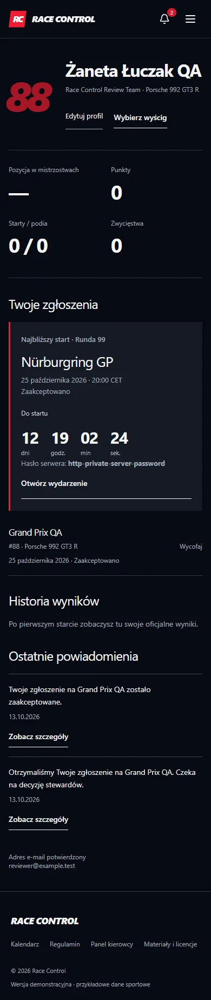

# RACE CONTROL

Platforma ligi simracingowej: konta kierowców, zapisy z decyzją stewardów, wyniki, klasyfikacja i trwałe powiadomienia. Demonstracja Next.js + PayloadCMS wdrażana na Vercel, z trwałą bazą Neon PostgreSQL i pocztą Resend. SQLite służy lokalnemu developmentowi.

Publiczny adres: https://race-control-rho.vercel.app · CMS: https://race-control-rho.vercel.app/admin · [Wdrożenie i obsługa](DEPLOYMENT.md). Wyniki testów publicznych są aktualizowane po wdrożeniu.




Zrzuty pochodzą z uruchomionej aplikacji. Panel kierowcy pokazuje konto testowe z osobnej bazy automatycznego scenariusza; nie jest makietą.

## Funkcje

- Rejestracja, logowanie, jednorazowe potwierdzenie e-mail i edycja profilu.
- Zgłoszenia na wyścigi: oczekujące, zaakceptowane, odrzucone i anulowane; kontrola pojemności i duplikatów.
- Prywatne hasło serwera dla zaakceptowanego kierowcy.
- Panel stewardów w wydarzeniu oraz pełny CMS pod `/admin`.
- Publikacja protokołów, kary, DNF/DSQ, osobne sklasyfikowanie i countback.
- Klasyfikacja aktywnego sezonu, wyniki poszczególnych rund i kariera kierowcy.
- Trwałe powiadomienia oraz kolejka e-mail z wysyłką po zatwierdzeniu transakcji.
- Countdown z rzeczywistej daty, aktualizowana dostępność, responsywne widoki i ograniczenie animacji.
- Licencjonowane fotografie oraz interaktywny SVG właściwej pętli Nürburgring GP.

Dane sportowe seeda są przykładowe. Fotografie przedstawiają rzeczywiste zawody, a nie sesje symulatora z kalendarza demo. [Materiały i licencje](ASSETS.md).

## Stack i architektura

Next.js 15.5.27 (App Router), React 19, TypeScript, PayloadCMS 3.90.2, Drizzle, SQLite lokalnie i Neon PostgreSQL na Vercelu. CSS/Tailwind obsługują layout; CSS, IntersectionObserver i Web Animations API obsługują ruch. Poczta: Nodemailer lub Resend. Testy: Node/tsx i Playwright z Chrome.

```text
src/app/(frontend)  publiczne strony i konto; renderowanie danych na serwerze
src/app/(payload)   panel CMS oraz natywne endpointy Payload
src/app/api         walidowane operacje konta, zapisów, decyzji i powiadomień
src/collections     modele, uprawnienia i podłączenie hooków Payload
src/lib             punktacja, transakcje, tokeny, poczta i wspólne projekcje
src/components      interakcje klienta i współdzielone elementy widoków
tests               jednostki, integracja, pełny scenariusz HTTP i przegląd widoków
```

Serwerowe strony korzystają z Local API Payload. Local API może ominąć uprawnienia, dlatego zapytania jawnie ograniczają publikację, sezon i pola przekazywane do klienta. Własne endpointy weryfikują sesję i rolę. Hooki kolekcji wspólnie egzekwują reguły operacji wykonywanych z CMS i API.

| Model                 | Rola                                                             |
| --------------------- | ---------------------------------------------------------------- |
| Users                 | Sesja Payload, rola, profil, weryfikacja i widoczność w rosterze |
| Races                 | Sezon, runda, termin, status zapisów, pojemność i prywatne hasło |
| Registrations         | Kierowca, wyścig, samochód, numer i decyzja stewardów            |
| Results               | Protokół wyścigu, pozycje, statusy, sklasyfikowanie i kary       |
| Announcements / Media | Komunikaty oraz biblioteka plików CMS                            |
| Notifications         | Wiadomości przypisane odbiorcy i trwały stan odczytu             |
| EmailOutbox           | Zatwierdzona kolejka dostawy, próby, błędy i status dostawcy     |

### Zapisy, punktacja i zdarzenia

Unikalny `activeKey` chroni przed kolejnym aktywnym zgłoszeniem tej samej osoby. Akceptacja sprawdza pojemność i rezerwuje miejsce z unikalnym `gridKey`. Konflikt transakcji odrzuca operację zamiast nadpisywać dane. Zachowanie pod obciążeniem PostgreSQL pozostaje do sprawdzenia.

Klasyfikacja używa **ID wyścigu**, a numer rundy jest etykietą. Wyniki liczą się po publikacji, dla publicznych wyścigów aktywnego sezonu. Sklasyfikowany DNF może punktować; DSQ i `classified=false` dają zero. Punkty karne zmniejszają dorobek. Remisy rozstrzyga liczba lepszych miejsc, a następnie stabilna kolejność.

Hook zapisuje powiadomienie i outbox w tej samej transakcji przez wspólny `req`. Nie wysyła poczty przez sieć. Worker czyta zatwierdzoną kolejkę, atomowo przejmuje rekord i obsługuje ograniczone ponowienia. Powtórny zapis niezmienionego statusu lub identycznych wyników nie generuje kolejnych zdarzeń.

## Uruchomienie lokalne

Wymagany Node.js 22, npm i Google Chrome do testów przeglądarkowych.

```powershell
npm ci
Copy-Item .env.example .env
```

Ustaw własny `PAYLOAD_SECRET`, minimum 32 znaki, zalecane 48 losowych bajtów zapisanych szesnastkowo. Wartość przykładowa jest odrzucana. Na **nowej** bazie:

```powershell
npm run db:push
npm run seed       # opcjonalne dane sportowe
npm run dev
```

W drugim terminalu:

```powershell
npm run mail:worker
```

Aplikacja: [localhost:3000](http://localhost:3000). Serwer domyślnie nasłuchuje tylko na tym komputerze.

Istniejąca baza w katalogu projektu jest przygotowana. Nie seeduj jej ponownie. Przed zmianą schematu wykonaj kopię SQLite i wyłącz serwer oraz worker. `db:push` jest lokalną synchronizacją schematu, nie zastępuje przeglądanych migracji produkcyjnych.

### Środowisko

Pełny wzór: [`.env.example`](.env.example).

| Zmienna                        | Znaczenie                                                               |
| ------------------------------ | ----------------------------------------------------------------------- |
| DATABASE_URL                   | Domyślnie `file:./racecontrol.db`; URL PostgreSQL wybiera drugi adapter |
| PAYLOAD_SECRET                 | Prywatny, losowy sekret sesji                                           |
| NEXT_PUBLIC_SERVER_URL         | Adres aplikacji i linków, lokalnie `http://localhost:3000`              |
| ACTIVE_SEASON                  | Sezon klasyfikacji; domyślnie `2026/2027`                               |
| PAYLOAD_DB_PUSH                | Pozostaw `false`; lokalny schemat zmieniaj jawnie                       |
| MAIL_MODE                      | `preview`, `smtp` lub `resend`                                          |
| SMTP_FROM                      | Nadawca we własnej zweryfikowanej domenie                               |
| SMTP_HOST / PORT / USER / PASS | Połączenie SMTP                                                         |
| RESEND_API_KEY                 | Klucz Resend; wyłącznie po stronie serwera                              |
| MAIL_PREVIEW_DIR               | Opcjonalny prywatny katalog lokalnej skrzynki, domyślnie `work/mail`    |

`preview` zapisuje HTML i JSON do lokalnego katalogu bez publicznego endpointu. Nie potwierdza otrzymania wiadomości przez skrzynkę. Tryb ten jest blokowany w workerze przy `NODE_ENV=production`. Prawdziwe SMTP/Resend wymagają testu dostarczenia.

### Prywatny administrator

Nie ma publicznych haseł demonstracyjnych. Seed tworzy losowe hasła, a znane hasła dawnych kont demo zostały wyłączone.

```powershell
$env:ADMIN_EMAIL = 'twoj-adres@example.com'
$env:ADMIN_PASSWORD = [Net.NetworkCredential]::new('', (Read-Host 'Hasło, minimum 14 znaków' -AsSecureString)).Password
npm run admin:create
Remove-Item Env:ADMIN_PASSWORD
```

Polecenie tworzy nowe konto, nie przejmuje istniejącego. Logowanie: `/login`; CMS: `/admin`. Kierowcy zakładają konto przez `/register`.

## Scenariusz demonstracji

1. Uruchom aplikację i worker. Załóż własne konto kierowcy.
2. Otwórz link z odpowiedniego pliku `work/mail/<id>.html` i kliknij „Potwierdź adres”. Token jest jednorazowy, ważny 24 godziny.
3. Zgłoś się na otwarty wyścig. Administrator zatwierdza zgłoszenie na stronie wydarzenia lub w Registrations w CMS.
4. Status i liczba zajętych miejsc aktualizują się co 15 sekund; zaakceptowany kierowca uzyskuje hasło serwera.
5. Administrator tworzy Results i publikuje protokół. Klasyfikacja oraz powiadomienia pokazują rzeczywistą zmianę.
6. Sprawdź konto, historię wyników, dzwonek, odczyt wiadomości i widok telefonu.

## Kontrole

Tryb developerski zapisuje artefakty w .next-development, a build i start produkcyjny w .next-production; mogą działać niezależnie.

```powershell
npm run lint
npm run format:check
npm test
npm run test:integration
npm run build
npm run typecheck
npm run test:e2e
# Przy uruchomionej lokalnej aplikacji z przygotowanymi danymi:
npm run test:visual
```

Integracja i pełny scenariusz przeglądarkowy tworzą oddzielne bazy w `work/`. Nie zmieniają sportowej bazy projektu. `test:e2e` wymaga wcześniejszego builda, wybiera wolny port i zamyka swój serwer. Nie uruchamiaj dwóch kopii tego samego zestawu jednocześnie. `test:visual` jest odczytowym przeglądem przygotowanego demo; `QA_BASE_URL` pozwala wskazać inny lokalny adres.

Aktualny zakres, wyniki oraz ograniczenia: [HANDOFF.md](HANDOFF.md). Omówienie projektu do rozmowy technicznej: [CASE_STUDY.md](CASE_STUDY.md).

## Wdrożenie i ograniczenia

To **lokalna demonstracja**, bez publicznego wdrożenia. Przed publikacją:

1. Skonfiguruj docelowy PostgreSQL, przygotuj migracje i sprawdź je na kopii bazy.
2. Ustaw sekrety, poprawny adres HTTPS, dostawcę poczty oraz `NODE_ENV=production` także dla workera. Sprawdź faktyczne otrzymanie wiadomości.
3. Wykonaj kontrole, `npm run build`, a następnie uruchom `npm start` oraz niezależny `npm run mail:worker` pod nadzorem procesów.
4. Udostępnij lokalny port przez poprawnie skonfigurowany reverse proxy HTTPS. Zapewnij kopie bazy i plików Media oraz monitoring kolejki i błędów.
5. Przeanalizuj zależności i bezpieczeństwo docelowego środowiska. Zweryfikuj również limity, retencję danych, odzyskiwanie kont i obowiązki operatora.

Usunięto nieaktualne pliki Docker z konfiguracją MongoDB, która nie odpowiadała aplikacji. Nie ma zweryfikowanego obrazu kontenerowego.

Audyt zależności pozostawia 9 zgłoszeń high łącznie, 4 po pominięciu devDependencies, w łańcuchu `braces`. Brak zaoferowanej poprawki dla źródłowego zgłoszenia w wykonanym audycie. Nie wykonano niezależnego pentestu, testów dużego obciążenia, migracji PostgreSQL ani testu prawdziwego telefonu. Emulacja szerokości i reduced motion nie zastępuje pomiaru na urządzeniu.

Fotografie i plan toru zachowują własne licencje Creative Commons, opisane w [ASSETS.md](ASSETS.md). Deklaracja MIT w package.json nie obejmuje tych materiałów.
